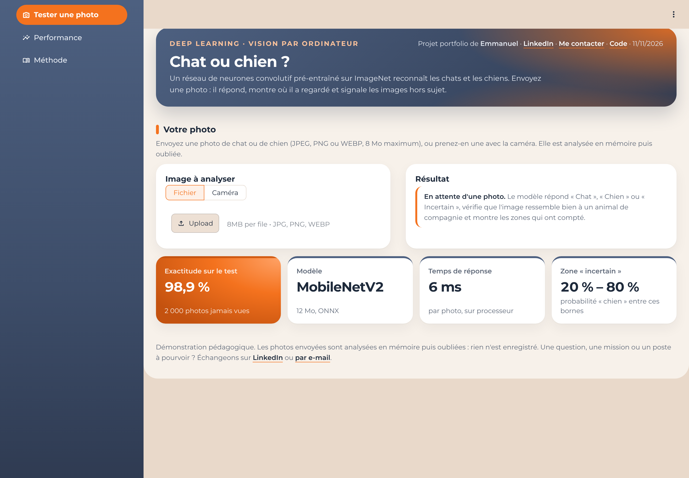
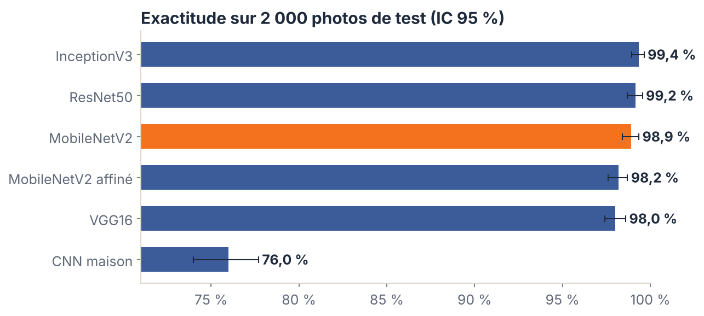
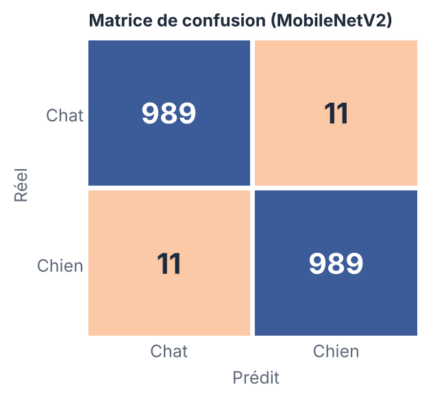
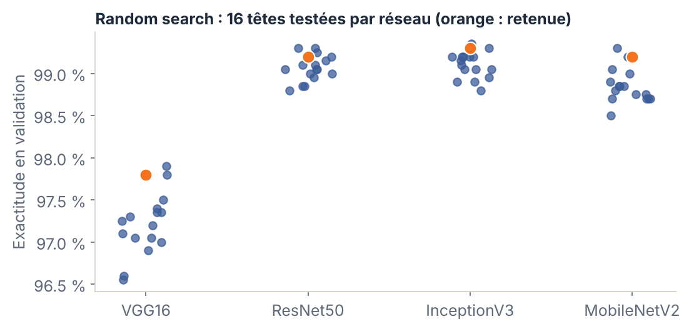
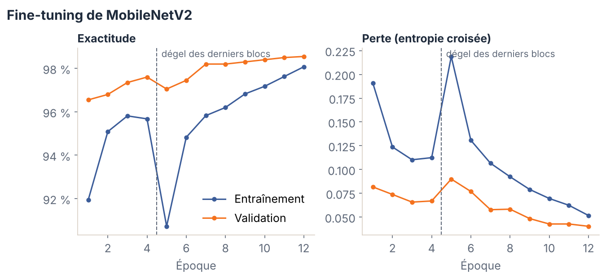

# Cats vs Dogs : classification d'images par deep learning, de l'entraînement à Kubernetes

[](https://github.com/mremmanuelgakpe-coding/cats-vs-dogs-classifier/actions/workflows/ci.yml)

> **Projet 7 du portfolio Data & IA : deep learning, classification Chat / Chien**
> Problématique : *comment reconnaître automatiquement un chat ou un chien sur une photo, et mettre ce modèle en production ?*

Six modèles sont comparés sur 2 000 photos jamais vues : un CNN entraîné de zéro, puis le **transfert learning** avec
**VGG16, ResNet50, InceptionV3 et MobileNetV2** (pré-entraînés sur ImageNet). Les hyperparamètres sont réglés par
**grid search** et **random search**, et MobileNetV2 est aussi **affiné (fine-tuning)**. Le modèle retenu est exporté en
**ONNX** et servi par une **API FastAPI sécurisée**, dans **Docker**, avec des manifests **Kubernetes** durcis.

| | Résultat (jeu de test, 2 000 photos jamais vues) |
|---|---|
| Modèle déployé | **MobileNetV2** gelé + tête réglée par random search (11,5 Mo, 224 px) |
| Exactitude | **98,9 %** (IC 95 % : 98,4 – 99,4 %), ROC AUC **0,9991** |
| Erreurs | **22 sur 2 000** : 11 chats vus comme chiens, 11 chiens vus comme chats |
| Réponses sûres | 99 % des photos, avec **99,5 %** d'exactitude ; le reste est déclaré « incertain » |
| Temps de réponse | **≈ 6 ms** par photo sur processeur (ONNX Runtime) |
| Meilleur score brut | InceptionV3 : 99,4 %, mais un modèle 8 fois plus lourd |

### Démo en ligne : [lien Streamlit à ajouter après déploiement](#lancer-le-projet)



La démo a trois pages : **Tester une photo** (fichier ou caméra : réponse, contrôle « est-ce bien un animal ? » et carte
des zones importantes), **Performance** (comparaison des 6 modèles, matrice de confusion, courbes, recherche
d'hyperparamètres) et **Méthode**.

---

## 1. Contexte et objectif

Classer une photo entre deux classes semble simple, mais les photos d'amateurs varient beaucoup : cadrage, lumière,
races, arrière-plans, plusieurs animaux, humains dans le champ. Le projet montre la démarche complète d'un modèle de
vision : partir d'un réseau entraîné de zéro, mesurer ce qu'apporte le transfert learning, régler les hyperparamètres
sans toucher au test, puis livrer un service fiable, rapide et sûr.

## 2. Données

| | |
|---|---|
| Source | Kaggle [Dogs vs. Cats](https://www.kaggle.com/c/dogs-vs-cats/data) (Asirra / Microsoft Research), via un miroir GitHub épinglé à un commit ([data/README.md](data/README.md)) |
| Photos | 24 989, étiquette dans le nom du fichier (`cat.123.jpg`), taille médiane 448 × 374 px |
| Contrôle qualité | 0 fichier illisible ; doublons repérés par empreinte exacte (SHA-256) et perceptuelle (pHash) : 5 copies exactes, 27 groupes quasi identiques, une seule photo gardée par groupe |
| Échantillon | 12 000 photos uniques (6 000 par classe), tirées au hasard : **8 000 entraînement / 2 000 validation / 2 000 test** |

Les doublons sont écartés **avant** le découpage : une même photo ne peut pas se retrouver dans l'entraînement et dans le
test (ce qui gonflerait le score). L'échantillon de 12 000 photos tient le temps de calcul sur processeur (pas de GPU).
**Les images ne sont pas republiées** : le dépôt contient seulement la liste des fichiers et leurs empreintes.

## 3. Méthodologie

1. **Référence : CNN maison.** 4 blocs convolution + normalisation + max-pooling, 128 px, augmentation (miroir, rotation,
   zoom, contraste), 390 000 paramètres, entraîné de zéro.
2. **Transfert learning.** VGG16, ResNet50, InceptionV3 et MobileNetV2, poids ImageNet officiels Keras (téléchargés depuis
   leurs publications GitHub et vérifiés par empreinte SHA-256). Réseaux gelés : chaque photo devient un vecteur de
   512 à 2 048 caractéristiques, mis en cache.
3. **Réglage des hyperparamètres**, sur la validation uniquement :
   - **grid search** d'une régression logistique (C ∈ {0,001 ; 0,01 ; 0,1 ; 1}, validation croisée 5 plis) ;
   - **random search** de 16 têtes Keras par réseau : couche cachée (0, 128, 256, 512 neurones), dropout, pénalité L2,
     taux d'apprentissage (log-uniforme), arrêt précoce.
4. **Fine-tuning de MobileNetV2** à 160 px : tête entraînée sur le réseau gelé, puis dégel des derniers blocs avec un taux
   d'apprentissage 50 fois plus faible.
5. **Choix du modèle déployé, défini avant de regarder le test** : parmi les modèles légers (< 20 Mo), celui qui a la plus
   petite perte logarithmique en validation. Le test (2 000 photos) n'est utilisé qu'une fois, à la fin.

| Modèle | Approche | Entrée | Exactitude test | IC 95 % | ROC AUC | Perte log |
|---|---|---|---|---|---|---|
| InceptionV3 | gelé + tête Keras | 224 px | **99,35 %** | 98,95 – 99,65 % | 0,9998 | 0,017 |
| ResNet50 | gelé + tête Keras | 224 px | 99,15 % | 98,70 – 99,55 % | 0,9996 | 0,027 |
| **MobileNetV2 (déployé)** | gelé + tête Keras | 224 px | **98,90 %** | 98,40 – 99,35 % | 0,9991 | 0,032 |
| MobileNetV2 affiné | fine-tuning | 160 px | 98,20 % | 97,60 – 98,70 % | 0,9988 | 0,047 |
| VGG16 | gelé + tête Keras | 160 px | 98,00 % | 97,40 – 98,60 % | 0,9977 | 0,063 |
| CNN maison | entraîné de zéro | 128 px | 76,00 % | 74,00 – 77,70 % | 0,8327 | 0,513 |

<p float="left">


</p>

**Lecture**
- Le transfert learning fait passer l'exactitude de **76 %** (CNN de zéro, 8 000 photos) à **98 – 99 %** : les filtres appris
  sur 1,2 million d'images ImageNet (dont des centaines de races de chiens et de chats) servent directement.
- Les trois meilleurs réseaux sont proches (intervalles de confiance qui se chevauchent). **MobileNetV2** est retenu car
  il est 8 fois plus léger qu'InceptionV3 (11,5 Mo contre ≈ 90 Mo) et 3 fois plus rapide, pour 0,45 point d'écart.
- Le **fine-tuning** à 160 px (98,2 %) fait moins bien que le réseau gelé à 224 px (98,9 %) : sur processeur, avec 8 époques,
  la résolution d'entrée compte plus que le dégel des derniers blocs. La perte de validation baissait encore à la
  dernière époque : un GPU et une résolution de 224 px sont la piste d'amélioration la plus directe.

<p float="left">


</p>

Têtes retenues par la recherche aléatoire (perte log en validation) : VGG16 128 neurones, dropout 0,2 (0,057) ;
ResNet50 128 neurones, dropout 0,4 (0,020) ; InceptionV3 512 neurones, dropout 0,5 (0,020) ; MobileNetV2 512 neurones,
dropout 0,4, taux 3 × 10⁻⁴ (0,024). Pour les quatre réseaux, la tête Keras bat la régression logistique.

## 4. Fiabilité : réponse « incertain », garde-fou et explication

- **Zone « incertain »** : si la probabilité « chien » est entre 20 % et 80 %, le modèle ne tranche pas. Cela concerne 21
  photos de test sur 2 000 ; sur les autres, l'exactitude monte à **99,5 %**.
- **Garde-fou « ni chat ni chien »** : le modèle ne connaît que deux classes et répond même pour une voiture. Un second
  réseau (MobileNetV2 complet, 1 000 classes ImageNet) calcule la part de probabilité portée par les races de chiens et
  de chats ; sous le seuil, l'image est signalée. Le seuil est fixé pour que **99 % des vraies photos de chats et chiens
  passent** (validation).
- **Carte d'occlusion** : on masque tour à tour chaque case d'une grille 8 × 8 et on mesure la baisse de confiance. La
  méthode ne dépend pas du type de réseau et tourne avec ONNX Runtime seul (≈ 0,5 s par photo).
- **Calibration** : aux extrêmes, où se trouvent 98 % des photos, la probabilité annoncée colle à la fréquence observée ;
  les tranches intermédiaires ne contiennent que quelques photos, d'où une courbe bruitée au centre
  ([figure](reports/figures/calibration.png)). C'est précisément la zone traitée comme « incertain ».

## 5. Mise en production

### API (FastAPI + ONNX Runtime)

Le modèle est exporté en **ONNX** avec son prétraitement : l'API n'embarque ni TensorFlow ni Keras (ONNX Runtime pèse quelques dizaines de Mo,
TensorFlow plusieurs centaines) et l'écart de prédiction Keras / ONNX reste inférieur à 2 × 10⁻⁴.

```bash
curl -s -H "X-API-Key: $API_KEY" -F "image=@mon_chat.jpg" "http://127.0.0.1:8000/predict?explain=false"
```
```json
{"label": "cat", "label_fr": "Chat", "probability_dog": 0.0, "confidence": 1.0, "looks_like_pet": true,
 "pet_score": 0.5691, "occlusion": null, "model_version": "mobilenet_v2-1.0.0"}
```

| Point d'accès | Rôle |
|---|---|
| `GET /health` | état du service (public, sondes Kubernetes) |
| `GET /model-info` | modèle, version, métriques, empreinte (clé requise) |
| `POST /predict` | photo en `multipart/form-data` ; `explain=true` ajoute la carte 8 × 8 (clé requise) |

### Sécurité

- **Clé API** dans l'en-tête `X-API-Key`, comparée à temps constant ; refus si aucune clé n'est configurée côté serveur.
- **Image contrôlée par son contenu**, pas par son extension : JPEG, PNG ou WEBP seulement, 8 Mo au plus, refus des
  « bombes de décompression » (plus de 40 millions de pixels), orientation EXIF appliquée puis métadonnées abandonnées.
- **Aucune photo écrite sur disque ni journalisée.**
- **Modèles vérifiés par empreinte SHA-256** avant chargement ; format ONNX (pas de pickle, pas de code exécuté au chargement).
- Prédictions simultanées plafonnées (protection contre l'épuisement CPU / mémoire), documentation désactivée par
  défaut, en-têtes `nosniff`, `no-store` et `Content-Security-Policy`.
- **Conteneur** non-root, système de fichiers en lecture seule, toutes les capacités Linux retirées.

### Kubernetes (`k8s/`)

| Fichier | Contenu |
|---|---|
| `namespace.yaml` | namespace `catdog` avec Pod Security Standards **restricted** |
| `deployment.yaml` | 2 réplicas, mise à jour sans coupure, sondes `/health`, requêtes et limites CPU / mémoire, non-root, lecture seule, `drop: ALL`, seccomp, pas de jeton de compte de service |
| `service.yaml` | Service ClusterIP (exposition publique via un Ingress TLS) |
| `hpa.yaml` | autoscaling de 2 à 6 pods à 70 % de CPU |
| `pdb.yaml` | au moins un pod disponible pendant les maintenances |
| `networkpolicy.yaml` | seul le port 8000 est ouvert ; **aucun trafic sortant** (le modèle est dans l'image) |
| `secret.example.yaml` | modèle de secret pour la clé API (la vraie clé n'est jamais versionnée) |

Les manifests sont validés en CI contre les schémas Kubernetes 1.31 (mode strict), et des tests vérifient les règles de
sécurité. Déploiement sur un cluster local [kind](https://kind.sigs.k8s.io/) :

```bash
make docker-build && make k8s-deploy
kubectl -n catdog port-forward svc/catdog-api 8000:80
```

## Lancer le projet

```bash
make install        # environnement d'entraînement (Python 3.12+, TensorFlow CPU)
make data weights   # images (miroir épinglé) et poids ImageNet, vérifiés par empreinte
make train          # extraction, grid + random search, fine-tuning, CNN maison (≈ 1 h 45 sur 2 cœurs CPU)
make evaluate       # test final, export ONNX, figures
make test           # 25 tests : décodage sûr, API, démo, données, Kubernetes
make demo           # démo Streamlit (ou double-clic sur lancer_demo.command sous macOS)
cp .env.example .env && make api                  # API sur http://127.0.0.1:8000
make docker-build && make docker-run
```

La démo et l'API n'ont besoin que des fichiers ONNX déjà présents dans `models/` : pas besoin de réentraîner.

**Démo en ligne** sur [Streamlit Community Cloud](https://share.streamlit.io) : dépôt, branche `main`, fichier
`demo/app.py`, Python 3.12. Les dépendances (sans TensorFlow) sont lues dans `demo/requirements.txt`.

## Structure

```
cats-vs-dogs-classifier/
├── api/main.py                  # API FastAPI sécurisée
├── demo/                        # démo Streamlit : app.py, ui.py, views/ (photo, performance, méthode)
├── k8s/                         # manifests Kubernetes (Deployment, Service, HPA, PDB, NetworkPolicy…)
├── src/catdog/
│   ├── config.py                # chemins, sources et empreintes des données et des poids
│   ├── data.py                  # contrôle qualité, doublons, échantillon et découpage
│   ├── features.py              # extraction des caractéristiques (réseaux gelés)
│   ├── heads.py                 # grid search + random search des têtes de classification
│   ├── nets.py                  # CNN maison et fine-tuning de MobileNetV2
│   ├── evaluate.py              # test final, choix du modèle, export ONNX, garde-fou
│   ├── inference.py             # décodage sûr, prédiction ONNX, carte d'occlusion
│   └── plots.py                 # figures
├── models/                      # model.onnx, pet_gate.onnx, model.meta.json (empreintes, métriques)
├── reports/                     # métriques, comparaison, essais de la recherche, figures
├── data/processed/manifest.csv  # liste des 12 000 photos et empreintes (pas d'images)
├── tests/                       # 25 tests
└── Dockerfile · Makefile · MODEL_CARD.md · .github/workflows/ci.yml
```

## Limites

- Deux classes seulement ; le garde-fou signale les images hors sujet mais ne les classe pas.
- Photos d'amateurs du jeu Asirra : les dessins, les photos très sombres, les animaux de dos ou plusieurs animaux à la
  fois sont moins bien traités.
- Entraînement sur processeur avec 12 000 photos sur 25 000 et des résolutions réduites pour VGG16 (160 px) et le
  fine-tuning (160 px) : un GPU permettrait d'aller plus loin.
- Le CNN maison est volontairement simple (référence) ; il est loin de l'état de l'art.

**Stack** : Python · TensorFlow / Keras · VGG16 · ResNet50 · InceptionV3 · MobileNetV2 · scikit-learn · ONNX Runtime ·
FastAPI · Streamlit · Docker · Kubernetes · GitHub Actions

---

Emmanuel · [LinkedIn](https://www.linkedin.com/in/egakpe) · [me contacter](mailto:mremmanuelgakpe@icloud.com)
